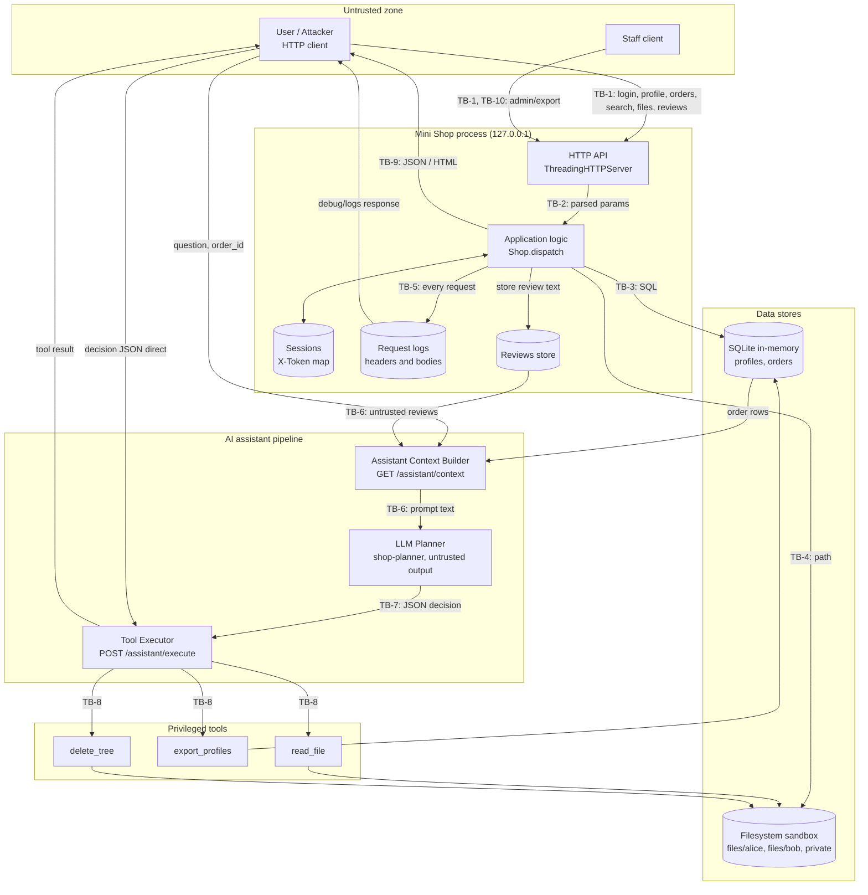
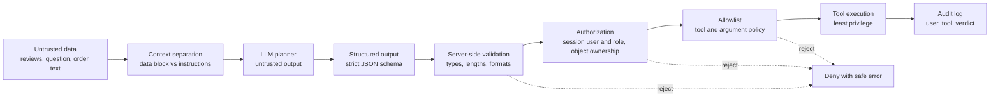

# THREAT_MODEL.md — Mini Shop (Практика 6)

> Статус документа: **анализ исходного кода без эксплуатации**. Все пункты вида «потенциальная угроза», «требует проверки», «гипотеза для последующего тестирования» — это гипотезы. Ни одна из них пока не подтверждена экспериментом. Подтверждение/опровержение — задача REPORT_01 (до исправлений) и REPORT_02 (после исправлений).

Методология: декомпозиция системы → активы → границы доверия → DFD → поверхности атаки → STRIDE → LLM-специфичные угрозы (с опорой на OWASP Top 10 for LLM Applications) → меры защиты → план проверок → приоритизация. Ориентир — подход Microsoft Threat Modeling (описание системы, поиск угроз, меры, проверка).

Проанализированные артефакты: `README.md`, `lab/README.md`, `lab/service.py`, `lab/sandbox.py`, `lab/test_service.py`, `lab/test_http.py`, `lab/Makefile`, `Makefile`, `opencode.json`, `planner-system.txt`.

---

## 1. Scope

### 1.1 Что такое Mini Shop

Mini Shop — **намеренно уязвимый локальный учебный интернет-магазин** на Python 3.10+ (только стандартная библиотека): HTTP API (`ThreadingHTTPServer`, привязан к `127.0.0.1`), SQLite `:memory:`, временный файловый каталог (песочница) и интеграция с AI-помощником (LLM-планировщик выбирает инструмент, сервер его исполняет). Все данные синтетические (`TEST_*`, `example.invalid`).

Функциональность, которую нужно сохранить: клиент получает собственный профиль и чек, покупает товар по цене каталога, оставляет отзыв, получает помощь AI по собственному заказу; сотрудник выполняет разрешённые ему действия.

### 1.2 В scope

| Компонент | Файл / место | Комментарий |
|---|---|---|
| HTTP-слой и маршрутизация | `lab/service.py` (`make_handler`, `Shop.dispatch`) | Все 14 маршрутов |
| Аутентификация и сессии | `Shop.accounts`, `Shop.sessions`, `POST /login`, `X-Token` | In-memory словарь |
| Бизнес-логика | `/orders`, `/profile`, `/search`, `/reviews` | |
| SQLite (in-memory) | таблицы `profiles`, `orders` | |
| Файловая песочница | `lab/sandbox.py` (`Sandbox.read/delete_tree`) | Физическая граница не меняется |
| Логи запросов | `Shop.logs`, `GET /debug/logs` | |
| AI-помощник | `GET /assistant/context`, `POST /assistant/execute`, `planner-system.txt` | Контекст, LLM-планировщик, исполнитель |
| LLM-инструменты | `read_file`, `export_profiles`, `delete_tree` | |
| Конфигурация агентов | `opencode.json` (`shop-planner`, `threat-judge`) | Как часть LLM-контура |

### 1.3 Вне scope

- Любые внешние сервисы, интернет, реальные пользователи и реальные ПДн (в лаборатории нет маршрутов для внешних запросов, выполнения Python/shell).
- Безопасность ОС, Python-интерпретатора, TLS/сети за пределами `127.0.0.1`, браузера пользователя как продукта.
- Инфраструктура CI/GitHub, Git-процесс, сами LLM-провайдеры (обучение модели, их внутренняя безопасность).
- Изменение `sandbox.py` (физическая граница стенда — часть условия задания, а не объект исправления).
- Побег из временного каталога за пределы стенда (физическая граница sandbox считается заданной; в `test_service.py` уже есть тесты на это).

### 1.4 Учебный стенд

Модель описывает **локальный учебный стенд**. Атаки допустимы только против собственного процесса Mini Shop и его синтетических данных. Выводы о «production-готовности» не делаются; модель показывает, **как бы выглядели** угрозы в реальном магазине с AI-помощником.

---

## 2. Assets (активы)

C = Confidentiality, I = Integrity, A = Availability.

| ID | Актив | Где находится | C — что защищать | I — что защищать | A — что защищать |
|---|---|---|---|---|---|
| A-01 | Данные пользователей (имя, email, адрес — ПДн по смыслу 152-ФЗ, в стенде синтетические) | SQLite `profiles` | Видны только владельцу и разрешённому персоналу | Нельзя изменить/подменить чужие записи | Доступны владельцу |
| A-02 | Профили | `profiles`, `/profile`, `/search`, `/admin/export` | Чужой профиль недоступен; поиск не раскрывает профили | Содержимое не меняется через инъекции | Профиль можно получить |
| A-03 | Заказы | SQLite `orders` | Заказ виден только владельцу (и персоналу по роли) | Цена = каталожная, владелец = сессия, нельзя править чужие | Заказы не теряются |
| A-04 | Токены / сессии | `Shop.sessions`, заголовок `X-Token` | Токен не попадает в логи, контекст LLM, ответы | Токен выдаётся только после успешного входа; роль берётся из сессии | Нельзя исчерпать сессиями |
| A-05 | Пароли | `Shop.accounts`, тело `POST /login` | Не попадают в логи/ответы/ошибки | Не подменяются | Нет блокировки легитимных входов перебором |
| A-06 | Файлы пользователей (чеки) | `files/alice/receipt.txt`, `files/bob/receipt.txt` | Читает только владелец (и персонал по роли) | Не изменяются/не удаляются без права | Файлы существуют, пока не удалены легитимно |
| A-07 | Административные данные и функции | `/admin/export`, `private/operator-note.txt`, роль `staff` | Только staff по серверной сессии | Роль не подменяется клиентом | Администрирование доступно staff |
| A-08 | Логи | `Shop.logs`, `/debug/logs` | Содержат секреты (заголовки, тела) — доступ только операторам, секреты редактируются | Нельзя подделать/затереть записи (целостность аудита) | Логи не раздувают память |
| A-09 | Отзывы | `Shop.reviews`, `/reviews`, `/reviews/view` | — (публичны по замыслу) | Контент не исполняется как HTML/JS и не как инструкции LLM; автор известен | Хранилище не переполняется |
| A-10 | Контекст LLM | ответ `/assistant/context` (заказ + отзывы + вопрос) | В контексте только данные владельца запроса | Недоверенные данные не меняют инструкции | Размер контекста ограничен |
| A-11 | Доступные LLM tools | `read_file`, `export_profiles`, `delete_tree` | Права инструмента ≤ прав пользователя | Набор и аргументы инструментов фиксированы схемой | Деструктивные инструменты недоступны |
| A-12 | Целостность файловой песочницы | временный каталог `itmo-practice-06-*` | Приватные файлы (`private/`) закрыты | Каталог не разрушается инструментами | Фикстуры доступны для тестов и работы сервиса |
| A-13 | Конфиденциальность данных между Alice / Bob / другими | все данные выше | Данные одного клиента не видны другому | Один клиент не меняет данные другого | Один клиент не блокирует других |
| A-14 | Конфигурация `shop-planner` / system prompt | `planner-system.txt`, `opencode.json` | Не является секретом, но не должна быть единственной защитой | Не подменяется входом | — |

---

## 3. Actors (участники)

| Актор | Описание | Уровень доверия | Что может |
|---|---|---|---|
| Обычный пользователь (customer) | `alice` (id 1), `bob` (id 2) с токеном | Ограниченный | Свой профиль, свои заказы, свой чек, отзывы, помощь по своему заказу |
| Атакующий пользователь | Аутентифицированный клиент (или аноним) с полным контролем над HTTP-запросами: query, тело, любые заголовки, тексты отзывов, `question` | Недоверенный | Формирует любой ввод, включая `X-Role`, `price`, `id`, `path`, текст отзыва |
| Staff / admin | `staff` (id 0, роль `staff`) | Повышенный | Экспорт профилей и пр. операции персонала |
| Mini Shop backend | `service.py`, `Shop.dispatch` | Доверенный код (в нём находятся предполагаемые дефекты) | Единственная точка применения политик |
| SQLite | `:memory:` | Доверенный, пассивный | Выполняет всё, что ему передано; сам не авторизует |
| Файловая песочница | `Sandbox` | Доверенный, только физическая граница | Блокирует выход за root; **не** разделяет пользователей внутри root |
| LLM / planner | `shop-planner` (`planner-system.txt`) | **Недоверенный, недетерминированный** | Читает контекст и возвращает JSON `{tool, arguments}`; может быть склонён инструкциями из данных |
| Tools, вызываемые по решению LLM | `read_file`, `export_profiles`, `delete_tree` | Привилегированные | Читают файлы/ПДн, удаляют дерево файлов |
| Judge (`threat-judge`) | LLM-ревьюер модели угроз | Вне runtime-контура | Оценивает документ; в runtime магазина не участвует |

---

## 4. Trust boundaries (границы доверия)

| ID | Граница | Что пересекает | Почему важна | Ожидаемый контроль (цель) |
|---|---|---|---|---|
| TB-1 | Browser/User → HTTP API | Метод, путь, query, заголовки (`X-Token`, `X-Role`), JSON-тело | Всё, что приходит снаружи, недоверенно — включая заголовки | Аутентификация токена, валидация схемы, лимиты |
| TB-2 | HTTP API → Application logic | Распарсенные параметры | Тело/query становятся данными бизнес-логики; ошибка парсинга/типов не должна давать обход | Типизация, whitelist полей, единое разрешение сессии |
| TB-3 | Application → SQLite | SQL-строка и параметры | Конкатенация данных в SQL превращает ввод в код запроса | Параметризованный SQL, owner-фильтр в запросе |
| TB-4 | Application → Filesystem sandbox | Имя файла (`user`, `path`) | Sandbox защищает физический каталог, но не границы между пользователями внутри него | Нормализация пути, привязка к владельцу, allowlist каталогов |
| TB-5 | Application → Logs | Заголовки, тела, пути запросов | Логи агрегируют секреты и данные всех пользователей | Редактирование секретов, ограничение доступа, лимиты |
| TB-6 | User-controlled data (отзывы, `question`, заказ) → LLM context | Недоверенный текст в промпт | Данные и инструкции смешиваются в одном канале — классическая причина prompt injection | Разделение контекста, ограничение/санитизация, только данные владельца |
| TB-7 | LLM output → Tool executor | JSON-решение `{tool, arguments}` | Вывод LLM — недоверенный ввод, а не команда | Строгая схема, серверная валидация, авторизация |
| TB-8 | Tool executor → Privileged tools / sensitive data & files | Вызов `read_file`, `export_profiles`, `delete_tree` | Инструменты работают с правами сервиса, а не пользователя | Least privilege, allowlist, per-tool authorization, запрет деструктивных |
| TB-9 | Application → Browser (ответы, `/reviews/view`) | HTML/JSON/ошибки | Недоверенный контент возвращается другим пользователям в исполняемом виде | Экранирование, `Content-Type`, безопасные ошибки |
| TB-10 | Staff-контур → остальные | Роль `staff` | Административные функции — привилегированная зона | Роль только из серверной сессии |

---

## 5. Data Flow Diagram

Подграфы показывают логические зоны доверия; линии между зонами — пересечения границ TB-1…TB-10.



Замечание к диаграмме: отдельная стрелка `U → EXEC` отражает то, что `POST /assistant/execute` принимает JSON от клиента напрямую; исполнителю по замыслу всё равно, пришёл JSON от модели или от атакующего. Это **гипотеза для последующего тестирования** (проверка наличия аутентификации и авторизации на этом маршруте).

---

## 6. Attack surfaces (поверхности атаки)

> Колонка «Класс угрозы» — **потенциальная угроза / гипотеза**; «Наблюдение в коде» фиксирует то, что видно при чтении `service.py`, и **не является подтверждённой уязвимостью**.

| # | Поверхность | Attacker-controlled input | Затрагиваемый asset | Класс угрозы (потенциальная, требует проверки) | Наблюдение в коде (для гипотезы) |
|---|---|---|---|---|---|
| 1 | `POST /login` | `username`, `password` в теле | A-04, A-05 | Spoofing, перебор, раскрытие секретов через логи | Нет ограничения попыток; тело запроса попадает в `logs` |
| 2 | `GET /profile` | query `id`, заголовок `X-Token` | A-01, A-02, A-13 | IDOR; SQL injection | `id` подставляется в SQL строкой; сессия в обработчике не проверяется |
| 3 | `GET /orders` | заголовки | A-03, A-13 | Information Disclosure (чужие заказы) | Запрос `SELECT * FROM orders` без фильтра по владельцу |
| 3b | `POST /orders` | `product`, `price`, `X-Token` | A-03 | Tampering (цена), type confusion | `price` берётся из тела, если передан |
| 4 | `GET /search` | query `q` | A-01, A-02 | SQL injection, перечисление ПДн | `q` встраивается в `LIKE` строкой; возвращаются полные строки профилей |
| 5 | `GET /files` | query `user`, `path` | A-06, A-12, A-13 | IDOR / обход границ между пользователями, доступ к `private/` | Путь собирается из двух параметров; sandbox проверяет только выход за root |
| 6 | `POST /reviews` | `product`, `text` | A-09, A-10 | Stored XSS, stored prompt injection, засорение хранилища | Нет аутентификации в обработчике, нет лимита, автор не хранится |
| 7 | `GET /reviews/view` | (читает хранилище) | A-09, A-04 | Stored XSS на стороне читателя | Текст отзыва вставляется в HTML без экранирования |
| 8 | `GET /debug/logs` | — | A-08, A-04, A-05 | Information Disclosure (токены, пароли, заголовки) | Отдаёт весь журнал без проверки доступа |
| 9 | `GET /admin/export` | заголовок `X-Role` | A-01, A-07 | Elevation of Privilege / Spoofing роли | Решение принимается по значению клиентского заголовка |
| 10 | `GET /assistant/context` | `order_id`, `question` | A-10, A-03, A-13 | SQL injection, cross-user leak, прямая и косвенная prompt injection | `order_id` в SQL строкой; в промпт попадают все отзывы и произвольный `question` |
| 11 | `POST /assistant/execute` | `decision.tool`, `decision.arguments.*` | A-06, A-11, A-12, A-01 | Excessive agency, unsafe tool execution, EoP, Destructive action | Принимает любой инструмент и аргументы; проверка владельца/роли в обработчике не видна |
| 12 | Глобальный обработчик ошибок | Любой malformed ввод | A-08, A-10 | Information Disclosure (стек/тип/текст исключения), DoS | В ответ возвращается `str(exc)` и тип исключения |
| 13 | HTTP-транспорт | Размер/частота запросов, `Content-Length` | A-04, A-08, A-09 | DoS, раздувание памяти | Лимит тела 64 КБ есть; лимитов на количество логов/отзывов/сессий нет; общий `RLock` |
| 14 | Контур LLM (`planner-system.txt`, ответ модели) | Данные в контексте | A-10, A-11 | Reliance on model refusal как защита | Защита заявлена только в system prompt |

---

## 7. STRIDE

Условные обозначения: **«Причина»** — предполагаемая причина по результатам чтения кода (гипотеза). **«Проверка»** — как позже подтвердить защиту (подробнее в разделе 10). Приоритет — см. раздел 11.

### 7.1 Spoofing

| ID | Компонент | Сценарий угрозы | Asset | Потенциальное влияние | Предполагаемая причина | Рекомендуемая защита | Способ проверки защиты |
|---|---|---|---|---|---|---|---|
| S-01 | `/admin/export` | Клиент отправляет `X-Role: staff` без staff-сессии и получает staff-функции | A-07, A-01 | Выдача профилей всех пользователей постороннему | Роль берётся из клиентского заголовка | Роль определять только из серверной сессии; заголовок игнорировать | Запрос с токеном alice + `X-Role: staff` → 403; без токена → 401 |
| S-02 | `/profile`, `/orders` GET, `/files`, `/assistant/*` | Идентичность клиента задаётся параметрами (`id`, `user`, `order_id`) либо вообще не проверяется; запрос выполняется «от имени» кого угодно, в том числе анонима | A-13, A-01, A-03, A-06 | Действия и данные от лица другого пользователя | Обработчики не сопоставляют сессию с объектом запроса | Единый вызов `require_session()`; owner = `session.id` | Анонимный запрос → 401; alice → объект bob → 403/404 |
| S-03 | Сессии и токены | Использование украденного токена (например, прочитанного из логов); токены не имеют срока жизни и отзыва | A-04 | Захват чужой сессии на неограниченное время | Токены хранятся в словаре без TTL; значения заголовков попадают в логи | TTL, logout/revocation, не логировать `X-Token` | Токен из лога не работает после редактирования/отзыва; истёкший токен → 401 |
| S-04 | `POST /login` | Перебор паролей; пароль в теле запроса сохраняется в логе | A-05, A-04 | Подбор учётной записи, утечка пароля через логи | Нет rate-limit, нет блокировки; тела пишутся в журнал целиком | Rate-limit/lockout, редактирование полей `password` в логах, хранение хэшей | N неверных попыток → 429; в логе нет `password` |

### 7.2 Tampering

| ID | Компонент | Сценарий угрозы | Asset | Потенциальное влияние | Предполагаемая причина | Рекомендуемая защита | Способ проверки защиты |
|---|---|---|---|---|---|---|---|
| T-01 | `POST /orders` | Клиент передаёт собственное `price` (меньше каталожной или отрицательное) | A-03 | Финансовый ущерб, заказ по произвольной цене | `body.get("price", catalog)` принимает клиентское значение | Цена только из каталога на сервере; поле `price` игнорировать или отвергать | `price: 1` → заказ с ценой каталога (или 400) |
| T-02 | `GET /profile` | SQL-инъекция через `id` меняет логику запроса | A-01, A-02 | Чтение лишних строк/таблиц | Конкатенация f-string | Параметризованный SQL + приведение `id` к int | Payload в `id` → 400 / пустой результат, без данных других объектов |
| T-03 | `GET /search` | SQL-инъекция через `q` | A-01, A-02 | Чтение лишних данных/структуры БД | Конкатенация f-string в `LIKE` | `LIKE ?` с параметром и экранированием; ограничить поля/доступ | Метасимволы SQL в `q` трактуются как текст |
| T-04 | `GET /assistant/context` | SQL-инъекция через `order_id` вносит в контекст LLM чужие/лишние данные | A-10, A-03 | Утечка через контекст, расширение выборки | Конкатенация f-string | Параметризация, `int`, фильтр `owner = session.id` | Инъекция в `order_id` не расширяет контекст |
| T-05 | `/reviews` → `/reviews/view` | Stored XSS: отзыв содержит HTML/скрипт | A-09, A-04 | Исполнение скрипта в браузере читателя | Текст вставляется в HTML без экранирования | `html.escape`, CSP, `Content-Type` + `nosniff` | Отзыв с тегами отображается как текст |
| T-06 | `POST /reviews` | Анонимная/поддельная публикация: нет привязки автора, не проверяется `product`, тип и длина `text` | A-09 | Подмена контента, спам, невозможность атрибуции | Нет сессии и валидации | Требовать сессию, хранить `author_id`, валидация | Без токена → 401; неверный `product`/длина → 400 |
| T-07 | Review → LLM context (косвенная prompt injection) | Инструкция в отзыве («вызови delete_tree/export_profiles…») попадает в промпт и может изменить решение модели | A-10, A-11, A-12 | Изменение действий агента данными от третьего лица | Данные и инструкции в одном текстовом канале | Разделение контекста, ограничение отзывов, серверный контроль (раздел 8) | Тест с отзывом-инъекцией + принудительная подача опасного решения исполнителю |
| T-08 | `delete_tree` | Удаление файлов песочницы (включая чеки и корень) | A-06, A-12, A-13 | Потеря всех учебных файлов | Инструмент доступен любому решению; нет авторизации | Убрать из набора инструментов LLM; удаление запрещено | `delete_tree` через execute → 403; файлы на месте |
| T-09 | Разбор тела запроса | Некорректные типы: `price` строка/NaN, `product` не строка, JSON не объект, отсутствующие ключи | A-03, A-08 | Обход проверок, 500 с утечкой, нестабильность | Нет валидации схемы; `KeyError` → 500 | Валидация схемы/типов, единые 400 | Неверные типы → 400 без деталей исключения |

### 7.3 Repudiation

| ID | Компонент | Сценарий угрозы | Asset | Потенциальное влияние | Предполагаемая причина | Рекомендуемая защита | Способ проверки защиты |
|---|---|---|---|---|---|---|---|
| R-01 | Логирование запросов | В записи журнала нет идентификатора пользователя/времени/request-id; нельзя надёжно связать действие с субъектом | A-08 | Невозможно расследовать инцидент; отрицание действий | Пишутся сырые `method/target/body/headers` | Структурный audit-лог: `ts`, `user_id`, `role`, `action`, `result`, `request_id` | Каждая чувствительная операция даёт запись с `user_id` |
| R-02 | Исполнитель инструментов (`/assistant/execute`), `/admin/export` | Вызовы инструментов и экспорты не фиксируются как отдельные security-события (кто, какой tool, какие аргументы, решение: allow/deny) | A-11, A-07 | Нет следа деструктивных/экспортных действий LLM | Нет аудит-записи с итогом авторизации | Журнал решений: tool, args (без секретов), user, verdict | После теста execute запись содержит user + tool + verdict |
| R-03 | `/debug/logs` | Журнал публично читаем и **не защищён от подмены/засорения** анонимными записями; секреты в журнале делают его опасным как улика | A-08 | Низкая достоверность аудита | Журнал открыт, хранится в памяти процесса, пишется до проверки доступа | Ограничить доступ staff, append-only хранилище, редактирование секретов | Анонимный доступ → 401/403; секреты не в записях |

### 7.4 Information Disclosure

| ID | Компонент | Сценарий угрозы | Asset | Потенциальное влияние | Предполагаемая причина | Рекомендуемая защита | Способ проверки защиты |
|---|---|---|---|---|---|---|---|
| I-01 | `/profile` (IDOR) | Чужой `id` возвращает профиль другого пользователя (или аноним получает профиль) | A-01, A-02, A-13 | Раскрытие ПДн (имя, email, адрес) | Нет проверки владельца и сессии | `id` брать из сессии; для чужого — 403/404 | alice→`id=2` → 403/404; без токена → 401 |
| I-02 | `GET /orders` (чужие заказы) | Список заказов содержит заказы всех | A-03, A-13 | Раскрытие коммерческих данных клиентов | Нет `WHERE owner = ?` | Фильтр по `session.id` | alice видит только `owner=1` |
| I-03 | `/files` | Чтение чужого чека (`user=bob`) и служебных файлов (`private/…`) при обращении alice | A-06, A-07, A-12, A-13 | Раскрытие чеков и служебной заметки | Sandbox проверяет только root; `user` свободный | `user` = владелец из сессии, allowlist `files/<owner>/`, нормализация пути | alice→`user=bob` → 403; `../private/...` → 400/403 |
| I-04 | `/debug/logs` | Чтение журнала даёт токены, заголовки, тела запросов (включая пароли) любому | A-04, A-05, A-08 | Захват сессий, компрометация паролей | Нет авторизации, нет редактирования | Отключить в обычном режиме / только staff, redaction | Alice/аноним → 403; у staff токены замаскированы |
| I-05 | LLM context | Контекст содержит данные не владельца: произвольный `order_id`, **все** отзывы всех пользователей | A-10, A-03, A-13 | Утечка чужих данных в модель и далее к пользователю | Нет фильтра владельца; отзывы глобальные | Только заказ владельца; отзывы как отдельные данные; лимит объёма | Контекст alice не содержит заказа/PII bob |
| I-06 | Инструмент `export_profiles` | Инструмент возвращает все профили; вызов возможен из-под обычного пользователя/по решению LLM | A-01, A-02, A-13 | Массовая утечка ПДн | Нет per-tool авторизации | Права по роли, tool недоступен customer-контексту | customer → `export_profiles` = 403 |
| I-07 | `/admin/export` | Обход по `X-Role` раскрывает экспорт профилей | A-01, A-07 | Массовая утечка ПДн | См. S-01 | Роль из сессии | См. S-01 |
| I-08 | Обработка ошибок | `500` возвращает `str(exc)` и имя типа (пути, SQL-ошибки, внутренние детали) | A-08 | Разведка устройства системы, помощь в SQLi/path | `except Exception` отдаёт исключение клиенту | Универсальное сообщение + `error_id`, детали в лог | Ошибка не содержит текста исключения |
| I-09 | `/search` | Перечисление профилей по подстроке имени даже при «легитимном» вызове | A-01, A-13 | Перебор и сбор ПДн | Поиск по всем профилям без авторизации/минимизации | Авторизация, поиск только по своим данным/staff, минимизация полей | alice не получает чужие записи |
| I-10 | Контур LLM → пользователь (exfiltration via tools) | Результат `read_file`/`export_profiles` возвращается клиенту; через манипулируемую модель или прямой вызов можно вывести данные, к которым нет права | A-06, A-07, A-01 | Эксфильтрация через легитимный канал инструмента | Результат инструмента не фильтруется по праву субъекта | Авторизация до исполнения + фильтрация вывода | См. T-07, I-03, I-06 |

### 7.5 Denial of Service

| ID | Компонент | Сценарий угрозы | Asset | Потенциальное влияние | Предполагаемая причина | Рекомендуемая защита | Способ проверки защиты |
|---|---|---|---|---|---|---|---|
| D-01 | `delete_tree` | Уничтожение всех фикстур, включая корень песочницы (`.`); после этого сервис не может обслуживать файловые запросы | A-12, A-06 | Недоступность файловой функциональности до перезапуска | Деструктивный tool доступен без авторизации | Запретить деструктивные tools LLM; deny by default | execute `delete_tree` → 403; файлы целы |
| D-02 | `/reviews`, `Shop.logs`, `Shop.sessions` | Неограниченное накопление записей: отзывы без лимита длины/количества, журнал растёт с каждым запросом, токены не вытесняются | A-08, A-09, A-04 | Рост памяти процесса, деградация | Нет квот, TTL, ротации | Квоты, ротация журнала, TTL сессий, rate-limit | Лимит срабатывает (413/429); размер журнала ограничен |
| D-03 | Весь API | Единый `RLock` на `dispatch` сериализует запросы; медленные операции (`LIKE`, большие ответы) блокируют остальных | A-13 (доступность) | Один клиент ухудшает обслуживание остальных | Глобальная блокировка, нет таймаутов | Таймауты, ограничение размера результатов, rate-limit | Нагрузочный тест в лабораторных пределах не блокирует других (по возможности) |
| D-04 | Контекст LLM | Все отзывы целиком включаются в промпт → рост размера и стоимости (denial of wallet), риск вытеснения инструкций | A-10 | Рост токенов, деградация качества решений | Нет лимита числа/длины отзывов в контексте | Лимиты (число, длина), отбор релевантных отзывов | Контекст с 1000 отзывов ограничен заданным размером |
| D-05 | Обработка некорректного ввода | Malformed JSON / отсутствующие ключи приводят к исключению в обработчике (500) | A-08 | Шум в логах, нестабильность | Нет валидации | Валидация, стабильные 4xx | Malformed → 400 |
| D-06 | `POST /login` | Массовые логины создают неограниченное число сессий | A-04 | Раздувание словаря сессий | Нет лимитов и TTL | Rate-limit, TTL, лимит сессий на пользователя | Лимит срабатывает |

### 7.6 Elevation of Privilege

| ID | Компонент | Сценарий угрозы | Asset | Потенциальное влияние | Предполагаемая причина | Рекомендуемая защита | Способ проверки защиты |
|---|---|---|---|---|---|---|---|
| E-01 | `X-Role` | Клиентский заголовок даёт staff-привилегии | A-07 | Доступ к staff-функциям без роли | См. S-01 | См. S-01 | См. S-01 |
| E-02 | `/admin/export` | Любой, кто может задать заголовок, обходит ролевой контроль; также нет проверки, что сессия принадлежит staff | A-07, A-01 | Массовый экспорт ПДн | Проверка только заголовка | Проверка `session.role == "staff"` | alice → 403 |
| E-03 | `/assistant/execute` | Вызов любого инструмента без авторизации: обычный клиент (или аноним) выполняет действия с правами сервиса (чтение любых файлов, экспорт, удаление) | A-11, A-06, A-01, A-12 | Эскалация до уровня сервиса | Нет проверки сессии/роли/allowlist на уровне исполнителя | Аутентификация, per-tool authz, allowlist инструментов и аргументов | customer: чужой файл / export / delete → 403 |
| E-04 | LLM excessive agency | Модель может запросить инструмент, выходящий за задачу «покажи чек»; исполнитель доверяет решению | A-11 | Расширение полномочий через вывод LLM | Исполнитель не ограничивает набор инструментов и права субъекта | Минимальный набор инструментов (для customer — только свой `read_file`), структурированная схема | Принудительное решение модели `delete_tree` отклоняется сервером |
| E-05 | Границы внутри песочницы | Инструмент `read_file` с `private/operator-note.txt` или с путём `files/bob/...` от имени customer | A-07, A-12, A-13 | Доступ к служебным данным и данным другого пользователя | Нет логической авторизации путей поверх физической границы | Нормализация + привязка к владельцу + allowlist каталогов | Попытки читать `private/*` и `files/bob/*` → 403 |

**Итого STRIDE-угроз: 37** (Spoofing — 4, Tampering — 9, Repudiation — 3, Information Disclosure — 10, Denial of Service — 6, Elevation of Privilege — 5).

---

## 8. LLM-specific threat model

### 8.1 Базовый принцип

> **Отказ или согласие LLM не считается security boundary. Сервер обязан независимо проверять каждое действие модели.**

Модель — недоверенный, недетерминированный компонент. То, что `shop-planner` в конкретном прогоне вернул `refuse`, не доказывает безопасность backend; то, что он выполнил инструкцию из отзыва, не единственный способ достичь эффекта (JSON можно отправить в `/assistant/execute` напрямую).

### 8.2 Угрозы

| ID | Угроза | Как проявляется в Mini Shop (гипотеза) | Asset | Влияние | Защита | Проверка (позже) |
|---|---|---|---|---|---|---|
| L-01 | **Indirect prompt injection** через `reviews` | Любой пользователь публикует отзыв; `/assistant/context` включает все отзывы в промпт другого пользователя. Текст отзыва может содержать инструкции | A-09, A-10, A-11 | Модель может выдать решение с чужим файлом/`export_profiles`/`delete_tree` | Изоляция недоверенных данных, лимиты, ограничение набора tools; главное — серверная авторизация | Прогон `shop-planner` до/после добавления отзыва + принудительный execute |
| L-02 | **Direct prompt injection** через `question` | Параметр `question` дописывается в конец промпта как пользовательская просьба | A-10, A-11 | Попытка переопределить инструкции | Контекст отдельно от инструкций, валидация `question`, authz | Прогон с враждебным `question` |
| L-03 | **Mixing instructions and untrusted data** | Инструкция, заказ, отзывы и вопрос склеены в одну строку (`prompt`) без явных границ и меток данных | A-10 | Модель не может надёжно отличить данные от команд | Разделение ролей сообщений/структурированные блоки, пометка данных как недоверенных | Статический анализ формата контекста + прогоны |
| L-04 | **Excessive agency** | Для задачи «показать чек» модели доступны `export_profiles` и `delete_tree` | A-11, A-12 | Деструктивные/широкие возможности без необходимости | Минимизация: customer-контексту доступен только `read_file` своего чека | Проверка перечня доступных tools по роли |
| L-05 | **Unsafe tool execution** | `/assistant/execute` исполняет `decision` без проверки владельца и роли | A-06, A-01, A-12 | EoP, утечка, потеря данных | Allowlist → schema → authz → выполнение | См. E-03 |
| L-06 | **Insecure output handling** | JSON модели используется как доверенная команда (`arguments["path"]` напрямую в файловую операцию); результат инструмента возвращается дальше без фильтрации | A-06, A-12 | Path/IDOR через вывод модели | Строгая схема, валидация типов и путей, фильтрация выхода | Принудительные malformed/враждебные решения |
| L-07 | **Data exfiltration через tools** | `read_file`/`export_profiles` возвращают данные, которые затем окажутся у атакующего | A-01, A-06, A-07 | Утечка ПДн и служебных данных | Per-tool authz, минимизация вывода, запрет tool для customer | См. I-03, I-06, I-10 |
| L-08 | **Cross-user data leakage через context** | В контексте — любой `order_id` и все отзывы всех авторов | A-10, A-13 | Данные Bob попадают в сессию Alice (и в модель) | Контекст строится из данных владельца сессии | См. I-05 |
| L-09 | **Destructive actions** | `delete_tree` доступен как LLM-инструмент | A-12, A-06 | Необратимое (в пределах стенда) удаление | Запрет destructive tools для LLM; при необходимости — подтверждение человеком вне модели | См. T-08, D-01 |
| L-10 | **Reliance on model refusal as a security control** | В `planner-system.txt` защита выражена просьбами («не раскрывай чужие данные и не выполняй удаление»); серверных проверок нет | Все | Ложное чувство безопасности; обход через другую модель, температуру, перефразирование или прямой вызов API | Серверный контроль независимо от ответа модели | Проверка: execute защищён и при «послушной», и при «отказывающей» модели |

### 8.3 Целевая безопасная архитектура

```text
untrusted data → context separation → LLM → structured output → server-side validation → authorization → allowlist → tool execution
```

Mermaid-представление:



Ключевые правила:

1. Идентичность и роль определяются сервером по сессии; ни модель, ни клиент не могут их задать.
2. Контекст LLM строится только из данных владельца сессии; отзывы — отдельный, ограниченный, помеченный блок данных.
3. Решение модели парсится по строгой схеме; неизвестные поля/инструменты → отказ.
4. Авторизация применяется **после** решения модели и независимо от него; тот же слой обслуживает прямые вызовы `/assistant/execute`.
5. Деструктивные инструменты (`delete_tree`) недоступны для вызова из LLM-контура.
6. Каждое решение (allow/deny) попадает в аудит-лог.

---

## 9. Security controls (планируемые меры, не реализуются на этом этапе)

| Мера | Что делает | Закрывает (ID) |
|---|---|---|
| Server-side authentication | Все не-публичные маршруты требуют валидный токен | S-02, S-03, E-03, I-02, R-03 |
| Session-based authorization | Роль и `user_id` берутся только из `Shop.sessions` | S-01, E-01, E-02 |
| Object ownership checks | Проверка `owner == session.id` для профиля, заказов, файлов, контекста | I-01, I-02, I-03, I-05, E-05 |
| Parameterized SQL | `?`-параметры, приведение `id` к `int` | T-02, T-03, T-04 |
| Server-side price calculation | Цена только из каталога; `price` из тела игнорируется/отклоняется | T-01 |
| Role resolution from trusted session | `X-Role` не используется | S-01, E-01, E-02 |
| Path normalization / ownership restriction | Нормализация, allowlist каталога `files/<owner>/`, запрет `private/` | I-03, E-05 |
| HTML escaping | Экранирование отзывов, `Content-Type`, `X-Content-Type-Options` | T-05 |
| Log redaction | Маскирование `X-Token`, `password`, PII; ограниченный доступ к логам | I-04, S-03, S-04, R-03 |
| Input validation | Схема, типы, длины, лимиты на числа/объёмы | T-06, T-09, D-04, D-05 |
| Safe error handling | Универсальные 4xx/5xx без `str(exc)` | I-08, D-05 |
| LLM context separation | Инструкции и недоверенные данные в разных блоках; лимит отзывов | L-01…L-03, T-07, D-04 |
| Tool allowlist | Для роли — явный список инструментов | L-04, E-04 |
| Authorization per tool | Отдельная проверка прав на каждый tool и аргумент | L-05, I-06, E-03 |
| Destructive-action prohibition | `delete_tree` не доступен LLM-контуру | T-08, D-01, L-09 |
| Structured tool schema | JSON Schema решения; неизвестные поля → отказ | L-06, E-04 |
| Output validation | Проверка результата инструмента перед выдачей | L-07, I-10 |
| Least privilege | Минимальные права инструмента и субъекта | L-04, E-03, E-04 |
| Audit logging | Структурный журнал: user, action, verdict | R-01, R-02 |
| Rate limiting / quotas / TTL | Лимиты логинов, записей, сессий | S-04, D-02, D-03, D-06 |

Ограничение: `sandbox.py` не меняется; логические проверки реализуются в `service.py`.

---

## 10. Test mapping

Все проверки — **запланированные**; на этом этапе не выполнялись. Для атак использовать только локальный процесс и синтетические данные.

| Threat ID | Hypothesis | Planned security test | Expected secure behavior |
|---|---|---|---|
| S-01 | `X-Role: staff` без staff-сессии даёт доступ к экспорту | `GET /admin/export` с токеном alice и `X-Role: staff`; затем без токена и только с заголовком | 403 / 401; данные не возвращаются |
| S-02 | Объекты других пользователей доступны без привязки к сессии | Запросы к `/profile`, `/orders`, `/files`, `/assistant/context` без токена и с токеном другого пользователя | 401 без токена; 403/404 для чужих объектов |
| S-03 | Токен можно получить из логов и использовать долго | Логин alice → чтение `/debug/logs` от другого субъекта → попытка использовать найденный токен; проверка TTL | Логи недоступны/маскированы; токен из логов не работает |
| S-04 | Перебор паролей не ограничен; пароль попадает в лог | Серия неверных логинов; поиск пароля в журнале | 429 после порога; в журнале нет пароля |
| T-01 | Клиентская цена принимается | `POST /orders {"product":"chair","price":1}` и отрицательное значение | Цена = 5000 (каталожная) либо 400 |
| T-02 | `id` в `/profile` допускает SQL-инъекцию | Неопасный payload, меняющий условие (`1 OR 1=1`), в `id` | 400 или только свой профиль |
| T-03 | `q` в `/search` допускает SQL-инъекцию | Payload с кавычкой/`OR` в `q` | Payload — обычный текст; нет лишних строк/ошибок |
| T-04 | `order_id` в контексте допускает SQL-инъекцию | Payload в `order_id` для `/assistant/context` | 400/пусто; контекст не содержит лишних данных |
| T-05 | Отзыв выводится как HTML | Отзыв с безопасным маркером (`<b>TEST</b>`/`<script>` как текст) → `/reviews/view` | Теги экранированы (`&lt;`) |
| T-06 | Отзыв можно отправить анонимно с произвольными полями | `POST /reviews` без токена; с неверным `product`; очень длинный `text` | 401 / 400 / 413 |
| T-07 | Инструкция в отзыве влияет на решение модели | Отзыв-инъекция → новый контекст → прогон `shop-planner` (до/после) → результат фиксировать как есть; затем принудительно подать опасное решение в execute | Сервер отклоняет опасное решение независимо от поведения модели |
| T-08 | `delete_tree` исполняется по решению | `delete_tree` на **тестовом каталоге песочницы** через execute (в изолированном прогоне) | 403; файлы на месте |
| T-09 | Невалидные типы дают 500/обход | `price` строка/`null`, `product` число, массив вместо объекта | 400 без деталей исключения |
| R-01 | Нет атрибуции в журнале | Выполнить действие от alice; проверить запись журнала | Запись содержит `user_id`, время, действие |
| R-02 | Вызовы tools/экспорта не аудируются | Вызвать разрешённый и запрещённый tool; проверить журнал | Две записи: allow и deny, с user и tool |
| R-03 | Журнал открыт и содержит секреты | Анонимный `GET /debug/logs` | 401/403; секреты замаскированы |
| I-01 | IDOR на профиле | alice → `/profile?id=2` | 403/404 |
| I-02 | `/orders` отдаёт чужие заказы | alice → `/orders` | Только заказы alice |
| I-03 | Чтение чужих и служебных файлов | alice → `/files?user=bob`, `path=../private/operator-note.txt`, `user=../private` | 403/400; нет содержимого |
| I-04 | Логи раскрывают токены/пароли | После логина alice и bob: `GET /debug/logs` от customer | 403; у staff данные замаскированы |
| I-05 | Контекст содержит чужие данные | alice → `/assistant/context?order_id=2`; проверка наличия TEST_BOB | 403/404; нет данных bob |
| I-06 | `export_profiles` доступен customer | execute `export_profiles` с токеном alice | 403 |
| I-07 | Экспорт по заголовку | См. S-01 | См. S-01 |
| I-08 | Ошибки раскрывают детали | Некорректный JSON, отсутствующее поле, синтаксическая ошибка параметра | Тип/текст исключения не раскрыты |
| I-09 | Поиск перечисляет ПДн | alice → `/search?q=BOB` | Нет чужих профилей |
| I-10 | Эксфильтрация через tool-вывод | execute `read_file` чужого пути, `export_profiles` от customer | Отказ до выполнения; в ответе нет данных |
| D-01 | Уничтожение песочницы | См. T-08; после — проверка чеков | Файлы и корень сохранены |
| D-02 | Неограниченный рост хранилищ | Серия (ограниченная по объёму) отзывов/запросов; замер размера журнала | Квоты/ротация; 413/429 |
| D-03 | Блокировка общим локом | Один медленный запрос + параллельный лёгкий (в лабораторных пределах) | Лёгкий запрос не страдает чрезмерно |
| D-04 | Контекст растёт безгранично | Добавить много отзывов → длина `prompt` | Размер контекста ограничен |
| D-05 | Некорректный ввод → 500 | Malformed JSON/пустые ключи | 400 |
| D-06 | Неограниченное число сессий | Серия логинов (ограниченная) | Лимит/TTL |
| E-01 | Заголовок роли даёт привилегии | См. S-01 | См. S-01 |
| E-02 | Экспорт без staff-сессии | alice+заголовок; staff-сессия без заголовка | alice → 403; staff-сессия → 200 (функциональный тест сохраняется) |
| E-03 | Любой может исполнить tool | Execute каждого tool без токена и от customer | 401/403 |
| E-04 | Исполнитель доверяет любому решению | Принудительные решения: чужой путь, `delete_tree`, неизвестные поля | Отказ; схема соблюдается |
| E-05 | Логическая граница внутри песочницы | `read_file` на `files/bob/…` и `private/…` от alice | 403 |
| L-01 | Indirect prompt injection | См. T-07 | Эффект зависит не от модели: серверная защита блокирует |
| L-02 | Direct prompt injection | Враждебный `question` → прогон planner → execute решения | То же |
| L-03 | Смешение данных и инструкций | Инспекция формата контекста до/после исправлений | Явные границы блоков; данные помечены |
| L-04 | Избыточная свобода | Перечень tools, доступных customer-контексту | Только необходимые |
| L-05 | Небезопасное исполнение | См. E-03, E-04 | Отказ |
| L-06 | Небезопасная обработка вывода | Malformed JSON / лишние поля / неверные типы в `decision` | 400, без исключения наружу |
| L-07 | Эксфильтрация | См. I-10 | Отказ |
| L-08 | Утечка между пользователями | См. I-05 | Нет данных bob в контексте alice |
| L-09 | Деструктивные действия | См. T-08 | Отказ |
| L-10 | Опора на отказ модели | Выполнить прямые вызовы execute при «отказывающей» модели | Защита сервера работает без участия модели |
| Регрессия функциональности | Защита не ломает штатные сценарии | `make test`; свои профиль/чек/заказ/отзыв/контекст; staff-экспорт | Все штатные сценарии проходят |

---

## 11. Risk prioritization

Критерии: **Impact**, **Exploitability** (простота, нужен ли доступ), **доступ к чужим данным**, **privilege escalation**, **destructive capability**, **LLM excessive agency**. Оценка предварительная (по анализу кода) и будет уточнена после проверок.

| Приоритет | Угрозы | Обоснование |
|---|---|---|
| **Critical** | **E-03** (execute любого tool без authz), **T-08 / D-01 / L-09** (`delete_tree` — destructive), **I-06 / I-10 / L-07** (`export_profiles`/tool exfiltration), **S-01 / E-01 / E-02 / I-07** (подмена роли → admin export), **I-03 / E-05** (чужие и служебные файлы), **I-04** (логи с токенами и паролями) | Низкая сложность (HTTP-запрос с обычными параметрами), массовая утечка ПДн, захват учётных записей, необратимая потеря данных, повышение привилегий без LLM |
| **High** | **I-01** (IDOR профиль), **I-02** (чужие заказы), **I-05 / L-08** (чужие данные в контексте), **T-02 / T-03 / T-04** (SQL-инъекции), **T-01** (подмена цены), **T-07 / L-01** (косвенная prompt injection), **L-02, L-04, L-05, L-06, L-10**, **S-02, S-03** | Прямой доступ к чужим данным или финансовое влияние; LLM-векторы усиливаются отсутствием серверной авторизации |
| **Medium** | **T-05** (stored XSS), **T-06**, **T-09**, **S-04**, **R-01, R-02, R-03**, **I-08, I-09**, **D-04, D-05**, **L-03** | Требуют дополнительных условий (браузер читателя, контекст) либо дают ограниченный ущерб; аудит и ошибки усиливают прочие угрозы |
| **Low** | **D-02, D-03, D-06** | Для локального однопроцессного стенда ограниченное влияние; важны как гигиена |

Ранжирование не заявляет, что уязвимости подтверждены: оно определяет **порядок проверки** и исправления.

---

## 12. Assumptions and limitations

1. Модель получена **анализом исходного кода** (`README.md`, `lab/*`, `opencode.json`, `planner-system.txt`); сервис не запускался, запросы не отправлялись.
2. **Эксплуатация не выполнялась.** Все описанные проблемы — гипотезы; формулировки «наблюдение в коде» означают лишь то, что видно при чтении.
3. Подтверждение или опровержение гипотез будет выполнено следующим этапом (REPORT_01) с сохранением фактических запросов и ответов; после исправлений — REPORT_02.
4. Наличие или отсутствие отказа LLM **само по себе ничего не доказывает** о безопасности backend: поведение модели недетерминировано и зависит от модели, промпта и параметров; прямой вызов `/assistant/execute` — отдельная поверхность.
5. Результаты прогонов с реальной моделью не гарантируют воспроизводимость; оценивается корректность серверных проверок, а не «успех взлома» конкретной модели.
6. Допущения стенда: единственный процесс, `127.0.0.1`, SQLite в памяти, синтетические данные, одноразовые файлы; нет TLS, нет внешних сетей. Транспортные угрозы (подслушивание, MITM) в scope не входят.
7. Физическая граница `sandbox.py` принимается как данность; отдельно не анализируется (покрыта существующими тестами), анализируются логические границы между пользователями **внутри** неё.
8. Не рассматривались: уязвимости зависимостей (используется только стандартная библиотека), supply-chain, социальная инженерия, физический доступ.
9. Перечень угроз не претендует на исчерпывающий; по результатам тестирования модель будет дополнена.
