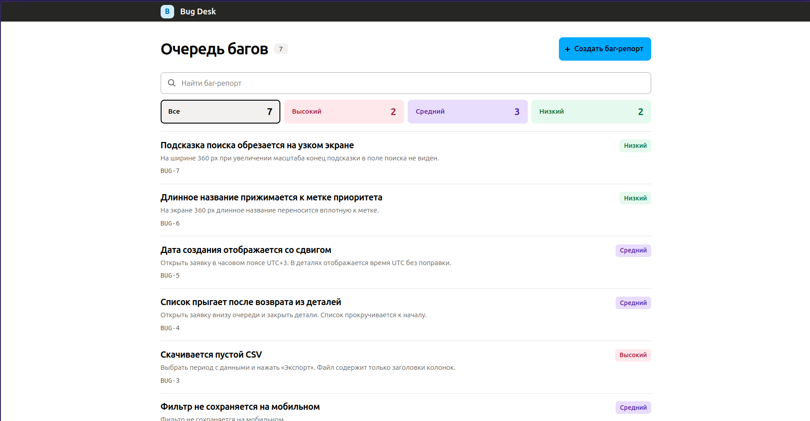

# Практика 8. Bug Desk

[Исходники для защиты · `feat/tickets-api`](https://github.com/At0-m/bug-desk/tree/feat/tickets-api) · [Кликабельный прототип](prototype/bug-desk-prototype.html)

Bug Desk — очередь баг-репортов для тестировщиков и разработчиков. Тестировщик открывает форму, вводит название, описание и приоритет, отправляет её и видит баг-репорт с ID в начале очереди. После обновления страницы запись остаётся в списке. Поиск работает по названию, описанию и BUG-ID. Плитки приоритетов показывают количество заявок и фильтруют очередь. Из списка можно открыть полное описание, приоритет и дату создания.



## Прототип и интерфейс

Кликабельный HTML-прототип создан с помощью ChatGPT и обновлён под редизайн. Откройте его в браузере. В нём доступны поиск, фильтры, детали и форма создания. Переключатель демонстрационных данных позволяет показать пустую очередь, загрузку, медленную отправку и ошибки.

Интерфейс реализован на React, TypeScript и Vite. Использована библиотека **Material UI (MUI)**. Кнопки, поля, диалог и сообщения собраны на готовых компонентах. В теме `client/src/theme.ts` заданы цвета, типографика, отступы и обводка фокуса. Визуальные референсы Avito и AKITA использованы для графитовой шапки, голубого основного действия и семантических цветов приоритета. На узком экране плитки переходят в сетку 2 × 2, а панель деталей раскрывается на весь экран.

При открытии формы фокус переходит в поле названия. Невалидный ввод отмечается сообщениями под полями, а фокус переводится на первое поле с ошибкой. Пока идёт отправка, кнопка отключена и повторный вызов обработчика блокируется. Если запрос завершился ошибкой, данные остаются в форме. После успешного создания поиск и фильтр сбрасываются, а заявка появляется первой в очереди. Детали можно закрыть клавишей Escape, после чего фокус возвращается к заявке.

## Живой прогон в учебном n8n

В режиме защиты React отправляет запрос на `/api/tickets`. Vite перенаправляет его на опубликованный webhook `Bug Desk API` в учебном n8n и добавляет заголовок `X-Bug-Desk-Token` на стороне прокси. Workflow читает и записывает заявки в Data Table `bug_desk_tickets`.

- **GET** читает таблицу и возвращает `200` с `{ tickets }`. При пустой таблице возвращается пустой массив.
- **POST** проверяет поля формы. Валидная заявка записывается через `Insert row`, возвращается `201` с `{ ticket }`. Ошибки проверки возвращаются со статусом `422` и объектом `{ message, fields }`.

В первом живом прогоне до редизайна очередь загрузила `BUG-1` из n8n. Затем из формы создали `BUG-2` «Фильтр не сохраняется на мобильном». Интерфейс подтвердил создание и показал заявку первой в очереди. В **Executions** запуск **#3641** прошёл через валидацию, `Insert row` и `Respond to Webhook1`. На скриншоте видны оба результата. [Живой прогон #3641](evidence/n8n/02-create-bug-2-execution-3641.png)

Обновлённая очередь загрузила из учебного n8n семь демонстрационных заявок. На свежем скрине фильтра «Средний» видны три соответствующие записи. [Очередь](evidence/redesign/01-queue-seven-tickets.png) · [Фильтр](evidence/redesign/02-priority-filter.png)

### Запуск из репозитория Bug Desk

В учебном n8n откройте опубликованный `Bug Desk API` и скопируйте **Production URL**. В терминале используйте Node.js 24. После команды `read` вставьте значение Header Auth и нажмите Enter. При вводе символы скрыты.

```bash
nvm use 24
cd client
npm ci
read -rs BUG_DESK_N8N_TOKEN
BUG_DESK_N8N_URL='PRODUCTION_URL_ИЗ_N8N' \
BUG_DESK_N8N_TOKEN="$BUG_DESK_N8N_TOKEN" \
npm run dev -- --host 127.0.0.1
```

### Локальная проверка с SQLite

В отдельном прогоне до редизайна на Node.js 24.22.3 использовалась пустая база SQLite. Приложение получило `GET 200`, создало заявку с ответом `POST 201` и после обновления страницы снова получило её через `GET 200`. В базе сохранилась одна запись. При ширине 360 px страница помещалась по ширине экрана. [Лог локального прогона](evidence/logs/live-scenario.log)

## Клиентские тесты

Playwright подменяет запросы к API через `page.route`. Фикстуры соответствуют контракту сервера, включая ответы `{ tickets }`, `{ ticket }` и ошибку валидации `{ message, fields }`. Тест повторной отправки удерживает ответ на `POST`, повторяет действия пользователя и проверяет, что до снятия задержки отправлен ровно один запрос.

После редизайна в Chromium прошли **40 из 40 тестов**. Это 20 сценариев на десктопе и при ширине 360 px. Они покрывают клавиатурную навигацию, валидацию, загрузку, пустую очередь, ошибки с повтором, поиск с фильтром, просмотр деталей, сброс фильтров после создания и появление новой заявки первой. Текстовые логи получены на копии исходников с временной конфигурацией сборки и браузера. [Скрин результата](evidence/redesign/04-playwright-40-passed.png) · [Текстовый лог повторной проверки с моками](evidence/logs/test-e2e-redesign.log)

В исходном наборе временное отключение сообщения об ошибке POST привело к падению шести тестов. После восстановления сообщения все 30 проверок исходного набора снова прошли.

```bash
# Из каталога client
npm run test:e2e:install
npm run test:e2e
npm run build
```

## Использование AI

- **Прототип.** ChatGPT собрал исходный экран очереди, форму создания и состояния сценария. Задача для AI была показать путь от пустой очереди или списка заявок до подтверждённого создания, включая задержку и ошибку.
- **Интерфейс.** Claude Code получил прототип и контракт API. В промпте было требование «Используй готовые MUI-компоненты для диалога, полей, кнопок и сообщений. Вынеси цвета, типографику и отступы в общую тему». Локальный SQLite API подготовлен с помощью ChatGPT. В учебном n8n workflow настроен вручную, а Claude Code подключил к нему Vite proxy и проверил проброс кодов ответа на тестовом webhook.
- **Тесты.** Claude Code получил требование удерживать ответ `POST` управляемой задержкой, повторить действия пользователя и проверить ровно один запрос. При сверке интерфейса с прототипом подписи перенесли над полями, а сброс формы привязали к закрытию диалога. Устойчивость проверок ошибок подтвердили прогоном с временно отключённым сообщением.
- **Редизайн.** Astra получила бриф с палитрой и промпт «Реализуй поиск, фильтрацию и детали на клиенте с текущим API n8n». После сверки превью уточнили цвета, добавили сценарии поиска и деталей, перенесли патч на актуальные исходники и исправили перехват фокуса после ошибки формы.

## Подтверждения

| Что показать | Материал |
| --- | --- |
| Актуальный интерфейс и единая тема | [Очередь с семью заявками](evidence/redesign/01-queue-seven-tickets.png) · [Фильтр «Средний»](evidence/redesign/02-priority-filter.png) · [Диалог создания](evidence/redesign/03-create-dialog.png) |
| Состояние обновлённой очереди до добавления демоданных | [Две исходные заявки](evidence/redesign/05-queue-before-demo-data.png) |
| Создание заявки через n8n до редизайна | [BUG-2 и успешный execution #3641](evidence/n8n/02-create-bug-2-execution-3641.png) |
| Тесты и сборка после редизайна | [40 прошедших тестов на скрине](evidence/redesign/04-playwright-40-passed.png) · [Лог проверки с моками](evidence/logs/test-e2e-redesign.log) · [Лог сборки](evidence/logs/build-redesign.log) |
| Состояния интерфейса до редизайна | [Загрузка](evidence/playwright/desktop-queue-loading.png) · [Блокировка отправки](evidence/playwright/desktop-post-pending.png) · [Валидация](evidence/playwright/desktop-validation-required.png) · [Ошибка 422 на 360 px](evidence/playwright/mobile-360-post-422-field-error.png) · [Ошибка POST с сохранённым вводом](evidence/playwright/desktop-post-error-input-kept.png) |
| Локальная проверка сохранения в SQLite до редизайна | [Скриншоты](evidence/live/) · [HTTP-запросы и содержимое базы](evidence/logs/live-scenario.log) |

## Сценарий защиты

1. Открыть HTML-прототип и обновлённый интерфейс. Показать тему MUI, поиск по BUG-ID, плитку приоритета и детали заявки.
2. Отправить пустую форму и показать подсказки. Заполнить форму и создать заявку. Показать новый BUG-ID в очереди, свежий запуск `POST` с `Insert row` в n8n и ту же заявку после обновления страницы.
3. Показать результат Playwright и тест в `client/e2e/create.spec.ts`. Объяснить, как `page.route` удерживает ответ, пока тест проверяет блокировку формы и ровно один `POST`.
